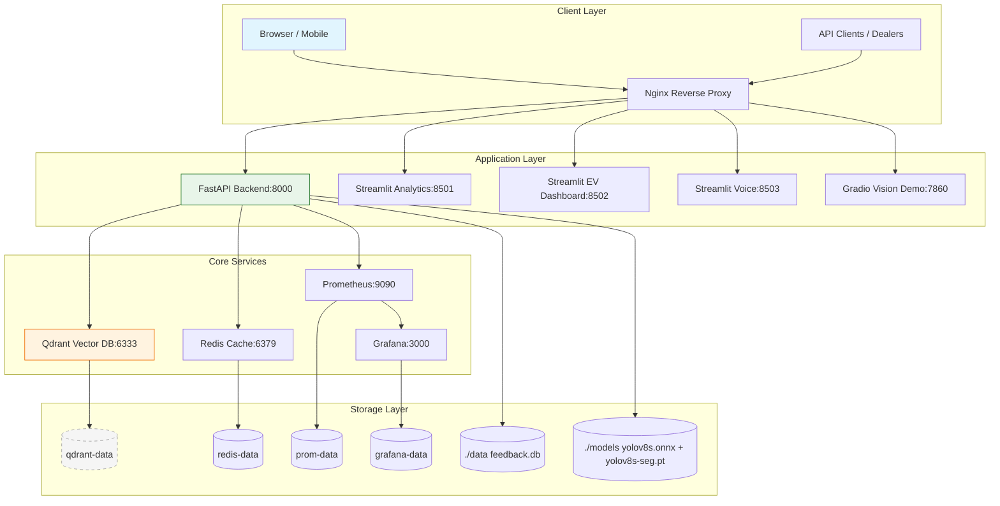
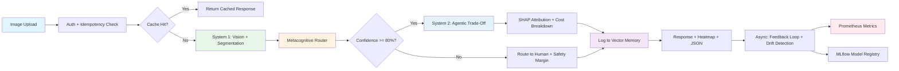
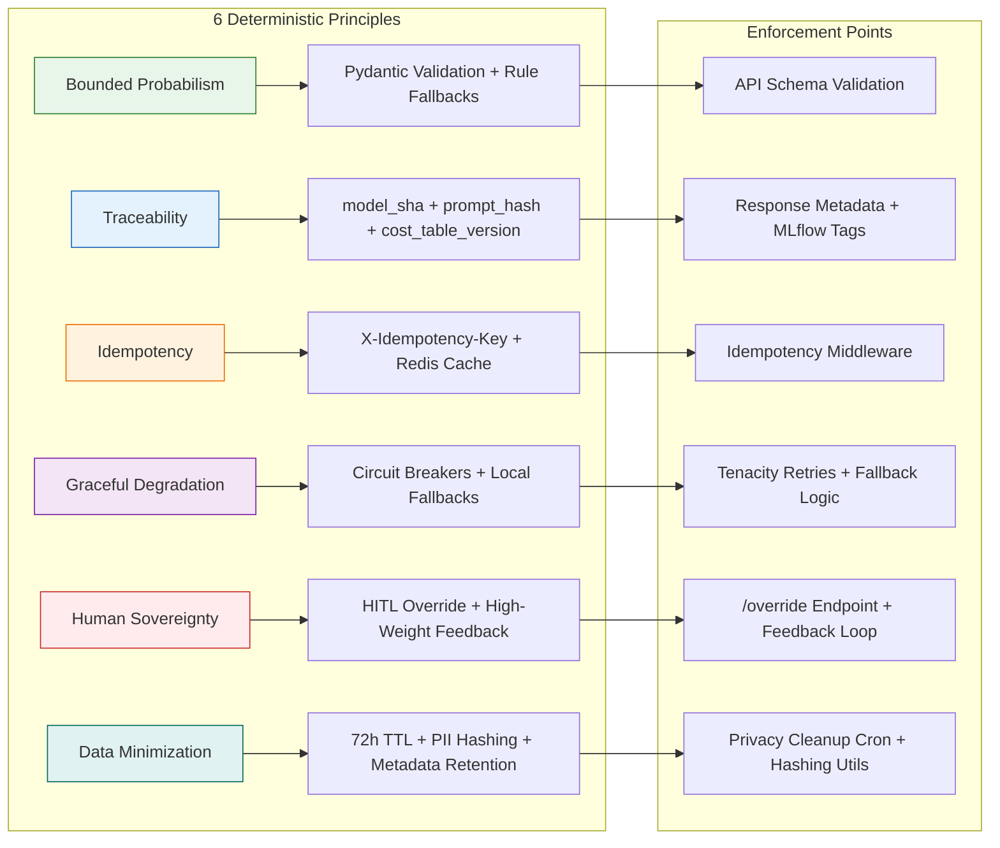
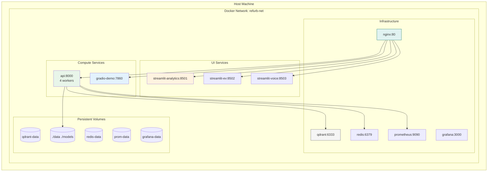

# RefurbCortex

AI-powered automotive damage inspection and refurbishment cost estimation for the Indian used-car market. Dual-process "System 1 / System 2" architecture: quantized vision for fast damage detection, metacognitive routing, an agentic trade-off engine (Groq + mem0), XAI cost attribution, and a human-in-the-loop feedback loop.

## High level System Architecture


## Dataflow pipeline


## Deterministic Principles layer


## Deployment Topology


## Core Modules

| File | Purpose |
|------|---------|
| `app/main.py` | FastAPI app factory, lifespan (Redis client init/close), middleware, router registration |
| `app/config.py` | Pydantic settings (feature flags, model paths, thresholds, web agent, segmentation, Redis) |
| `app/api/v1/schema.py` | Pydantic request/response schemas (`DamageRecord` incl. `bbox`, `InspectionResponse`, `SHAPBreakdown`) |
| `app/api/v1/inspection.py` | `POST /predict` — main inspection endpoint (image + vehicle metadata form) |
| `app/api/v1/webhooks.py` | `GET/POST /status/<id>` — Redis-backed inspection status store with memory fallback |
| `app/api/v1/feedback.py` | `POST /feedback` — API-key protected feedback submission |
| `app/api/v1/hitl.py` | `POST /override` — API-key protected human-in-the-loop correction |
| `app/api/v1/voice.py`, `webhooks.py`, `insurance.py`, `twin.py`, `batch.py` | Optional feature routers behind env flags |
| `app/core/system1_vision.py` | YOLOv8 detection + optional instance segmentation (`yolov8s-seg.pt`), mask-based damage area/severity with bbox fallback |
| `app/core/system2_agent.py` | Groq LLM + mem0 agentic trade-off (REPAIR / AS_IS / PARTIAL), graceful degradation when Qdrant/GROQ unavailable |
| `app/core/cost_estimator.py` | Deterministic thread-safe LRU cost model (Indian market, labor by city tier, paint, age/mileage factors) |
| `app/core/xai_engine.py` | SHAP attribution on RandomForest regressor (top-3 cost drivers) |
| `app/core/metacognitive.py` | Confidence calibration + ChromaDB error memory + safety margins |
| `app/core/ev_soh_forecaster.py` | EV battery state-of-health forecasting |
| `app/core/dataloader.py` | Historical repair-cost CSV lookup |
| `app/core/security.py` | API key verification (fail-closed when `API_KEY` unset) |
| `app/core/quantized_vision.py` | Quantized ONNX vision variant |
| `app/services/web_agent_async.py` | DuckDuckGo parallel search pipeline (standard=5 / reasoning=12 / deep=30 searches) + price extraction |
| `app/services/audit_export.py` | WeasyPrint PDF audit export |
| `app/middleware/idempotency.py` | `X-Idempotency-Key` middleware, Redis-backed cross-worker dedup with memory fallback |
| `app/middleware/prometheus_metrics.py` | Prometheus middleware + gauges for web/segmentation/Redis observability |
| `app/services/offline_sync.py` | Offline sync queue |
| `app/services/metrics_drift.py` | Metrics drift monitoring |
| `app/utils/logger.py` | Loguru app logger |
| `app/utils/versioning.py` | System metadata |
| `app/utils/image_ops.py` | Image processing helpers |
| `app/utils/privacy.py` | Upload cleanup cron |

## Configuration (`app/config.py`)

Key settings (loadable from `.env`):

| Setting | Default | Description |
|---------|---------|-------------|
| `YOLO_MODEL_PATH` | `./models/yolov8s.pt` | Detection model weights |
| `YOLO_SEG_MODEL_PATH` | `./models/yolov8s-seg.pt` | Segmentation model weights (optional; bbox fallback if missing) |
| `REPAIR_COST_PATH` | `./data/indian_vehicle_refurbishment.csv` | Historical repair cost dataset |
| `CONFIDENCE_THRESH` | `0.45` | YOLO detection confidence threshold |
| `CONFIDENCE_ROUTING_THRESH` | `0.8` | Metacognitive routing confidence threshold |
| `WEB_PROVIDER` | `duckduckgo` | Web enrichment provider |
| `WEB_MODE` | `standard` | `standard` (5 searches) \| `reasoning` (12) \| `deep` (30) |
| `WEB_SEARCH_BASE_URL` | `https://html.duckduckgo.com/html/` | DuckDuckGo HTML endpoint |
| `REDIS_URL` | `redis://localhost:6379` | Redis connection URL |
| `REDIS_STATUS_TTL_SECONDS` | `86400` | Status key TTL |
| `API_KEY` | `""` | Bearer token for `/predict`, `/feedback`, `/override`, `/metrics` (fail-closed if unset) |
| `GROQ_API_KEY` | `""` | System 2 LLM key |
| `ENABLE_INSURANCE`, `ENABLE_MULTILINGUAL_VOICE`, `ENABLE_DIGITAL_TWIN`, `ENABLE_AIRGAPPED` | `false` | Feature flags |

## Environment

**Conda (recommended for local dev):**
```bash
conda env create -f environment.yml   # Python 3.11
conda activate refurbcortex
pip install -r requirements.txt       # PyPI-only extras (slowapi, groq, duckduckgo-search, ...)
```

**Docker Compose (full stack):**
```bash
docker-compose up -d --build
```
Services: API (8000), Qdrant (6333), Redis (6379), Prometheus (9090), Grafana (3000), Nginx (80), Streamlit dashboards (8501/8502/8503), Gradio vision demo (7860).

> `.env` contains live API keys — rotate `API_KEY` and `GROQ_API_KEY` before sharing or publishing. `.env` is gitignored; do not commit it.

## Running

**Local API (degrades gracefully without Qdrant/Redis):**
```bash
conda activate refurbcortex
uvicorn app.main:app --reload --port 8000
```

**End-to-end smoke test:**
```bash
# POST /predict (include X-API-Key)
curl -X POST http://localhost:8000/api/v1/predict \
  -H "X-API-Key: $API_KEY" \
  -F file=@path/to/vehicle.jpg \
  -F vehicle_brand=Maruti \
  -F vehicle_model=Swift \
  -F manufacture_year=2018 \
  -F fuel_type=petrol \
  -F panel_affected=front_bumper \
  -F damage_category=dent \
  -F city=Delhi \
  -F city_tier=tier_1

# Capture inspection_id from response, then:
curl http://localhost:8000/api/v1/webhooks/status/<inspection_id> \
  -H "X-API-Key: $API_KEY"

curl http://localhost:8000/health
curl http://localhost:8000/metrics
```

## Testing & CI

```bash
pytest                       # run test suite (11 tests)
pytest -v                    # verbose
ruff check app/ scripts/ tests/   # lint
python -m py_compile app/**/*.py   # compile check
```

CI runs on every push/PR to `main` (`.github/workflows/ci.yml`): ruff lint → py_compile → pytest on Python 3.11.

### Test files
- `tests/test_schema.py` — `DamageRecord` accepts `bbox`, severity bounds
- `tests/test_cost_estimator.py` — deterministic output, area variance, bounded costs
- `tests/test_web_agent.py` — price extraction, default normalization
- `tests/test_status_store.py` — Redis-backed status store roundtrip + memory fallback

## Segmentation model (optional but recommended)

System 1 uses instance segmentation for true damage mask area and coverage-based severity when `models/yolov8s-seg.pt` is present. Download it:

```bash
yolo export model=yolov8s-seg format=pt   # saves to ./models/yolov8s-seg.pt
```

If absent, the pipeline falls back to bounding-box heuristics without erroring. The file is large (~24 MB) and gitignored via `*.pt`.

## Production checklist (P0)

- [ ] Rotate `API_KEY` and `GROQ_API_KEY` in `.env` (never commit `.env`)
- [ ] Confirm `docker-compose up -d --build` completes and `/health` returns healthy
- [ ] Validate `POST /predict` → `GET /api/v1/webhooks/status/<id>` Redis roundtrip
- [ ] Run `pytest` (green) before deploying
- [ ] Align worker count (compose and Dockerfile both `--workers 4`; state is Redis-backed)
- [ ] Set `WEB_MODE=deep` for production pricing accuracy (more searches = higher latency)
